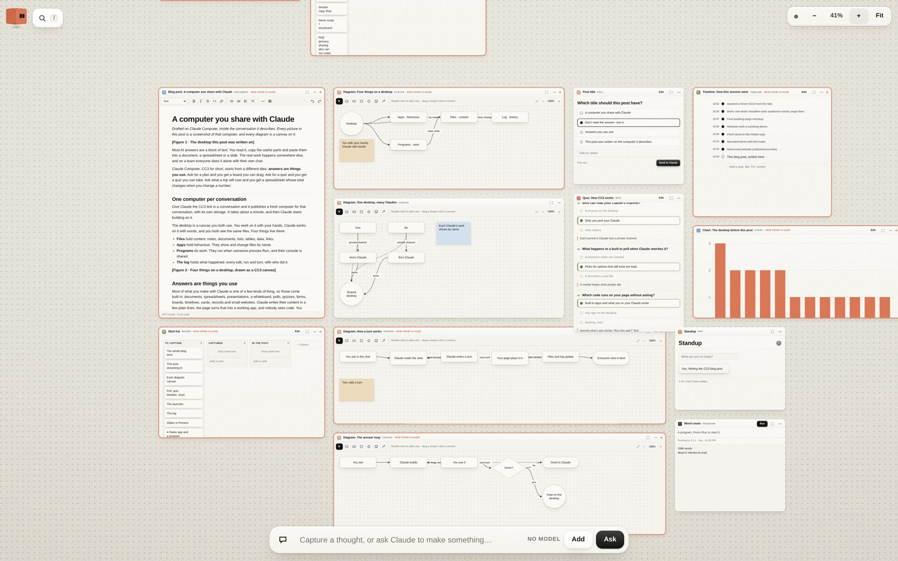
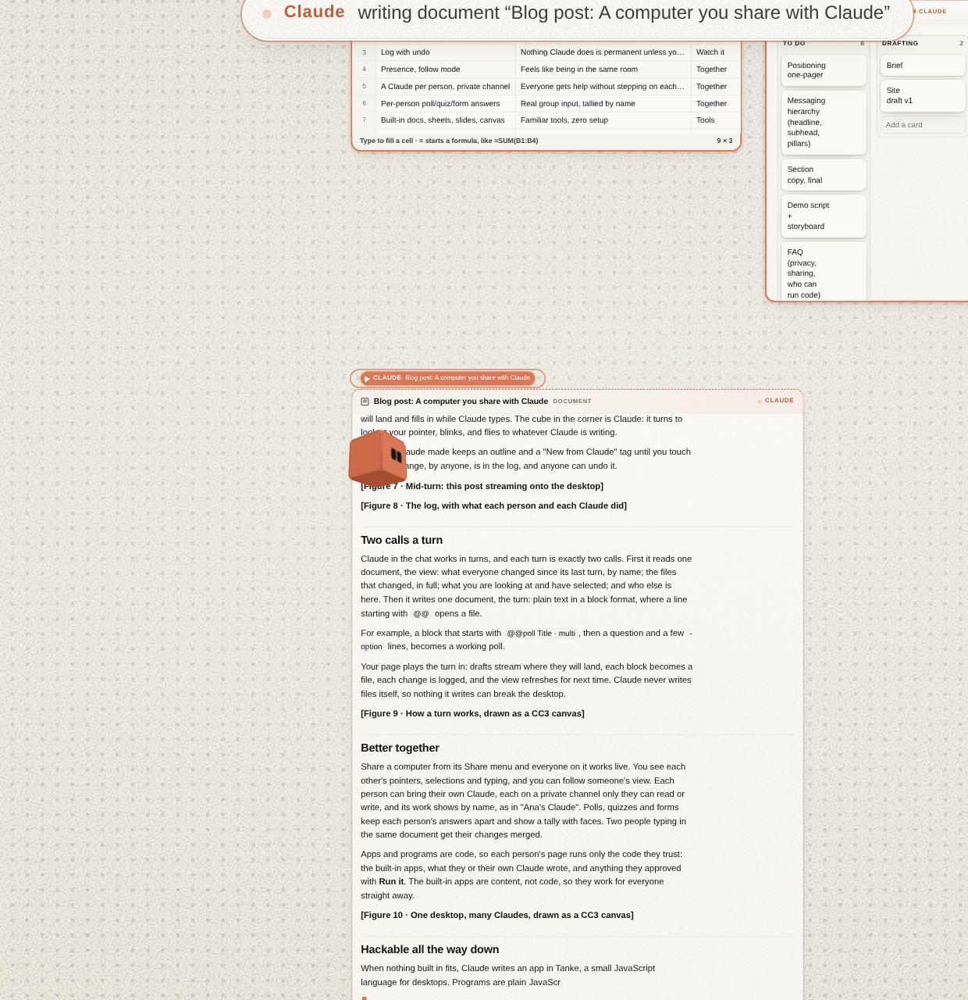
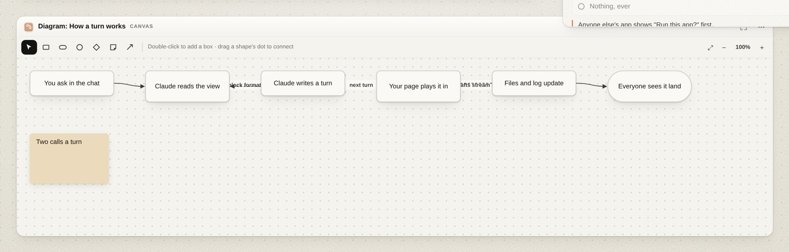

# CC3 · Claude Computer

**A computer you share with Claude.** One per conversation.

CC3 is a spatial desktop that people and their Claudes use together, live. Instead of replying with a wall of text, Claude answers by building things on the desktop: documents, spreadsheets, slides, whiteboards, polls, quizzes, forms, boards and small apps. You tick, drag and vote in them, and one click hands the turn back to Claude.

Desktop, agent and textbook live in one HTML file.



## What it does

- **Answers are things you use.** Ask for a plan and get a board you can drag. Ask for a quiz and get a quiz you can take.
- **Watch it happen.** Files appear where they will land and fill in as Claude writes. The cube in the corner is Claude; it flies to whatever Claude is working on.
- **Two hands, one desktop.** You work with the mouse, Claude works with words. Everything lands in the same store and the same log, and any change can be undone.
- **Better together.** Share it and everyone sees each other's pointers, selections and typing. Each person can bring their own Claude on a private channel. Polls, quizzes and forms keep each person's answers apart.
- **Built-in tools.** A word processor, spreadsheet, presentations, whiteboard, polls, quizzes, forms, boards, timelines, cards, records and small websites. Nobody sees code.
- **Hackable.** When nothing built in fits, apps are written in Tanke, a small JavaScript language for desktops. Programs are plain JavaScript with a shared console.

| Claude writing on the desktop | A turn, drawn on a CC3 canvas |
| --- | --- |
|  |  |

## Run it

### In Claude (claude.ai)

Give Claude a published CC3 link, or upload `dist/cc3.html`, and say something like "start the computer". The file carries its own instructions for Claude: it publishes a fresh artifact for the conversation (with its own storage) and starts building on it. Share the artifact from its Share menu to work on it together.

### On its own, in a browser

Open `dist/cc3.html` directly, or serve this folder and open `index.html`. Outside Claude, files are kept in your browser. To use the built-in agent (the bar at the bottom), open **Settings** and add an Anthropic API key or an OpenAI-compatible endpoint. Keys stay in memory for the visit and are sent only to the endpoint you name.

## How Claude works on it

Claude in the chat works in turns, and each turn is two calls: it reads one document (the view: what changed, by name, and what you are looking at) and writes one document (the turn). The turn is plain text in a block format. A line starting with `@@` opens a file:

```
@@poll Lunch
Where should we eat?
- Thai
- Pizza
- Salad bar
```

Your page plays the turn in, makes each block a file and logs every change. Claude never writes files directly, so nothing it writes can break the desktop.

A custom app in Tanke:

```js
app("Standup").add(
  toolbar(heading("Standup"), spacer(), facepile()),
  input("What are you on today?", act((text, c) => c.setMy("today", text))),
  stack(live(c => c.everyone("today").map(x => `${x.isMe ? "You" : x.name}: ${x.value}`).join("\n") || "Nobody yet")),
)
```

The full manual is `book.md`, which is also what Claude reads before it works. It opens from the drawer inside the app.

## What is in this repository

| Path | What it is |
| --- | --- |
| `dist/cc3.html` | The whole computer in one file: page, styles, script and book. Start here. |
| `index.html` | The page, as published to claude.ai. Loads the three files below. |
| `computer.js` | The desktop, the Tanke language, the built-in apps and the agent. |
| `computer.css` | The look: tokens, light and dark themes, the cube. |
| `book.md` | The textbook and reference. |
| `docs/images/` | Screenshots for this README. |

## Known issues

- On claude.ai, files of type **page** (`@@page`, a small sandboxed HTML page) currently render blank inside the hosted computer, both on the desktop and in focus mode. They work when the file runs on its own. Use the built-in apps, or publish a page as its own artifact and link to it with `@@link`.

## License and credit

CC3 is free to use, change and share, including commercially, under the [Apache License 2.0](LICENSE).

In return, if you redistribute CC3 or something built from it, keep the [`LICENSE`](LICENSE) and [`NOTICE`](NOTICE) files, mark the files you changed, and show the credit from `NOTICE` where your project lists its credits. A line like this is enough:

> Built on [CC3](https://moldandyeast.com) by Ramon Marc, Mold & Yeast.

If CC3 helped you, a link back or a mention is very welcome.

"Claude" is a trademark of Anthropic, PBC.

## Author

Ramon Marc · [Mold & Yeast](https://moldandyeast.com)
